# Fase 0 — Diseño de arquitectura

> **Banking Agentic Assistant**: asistente de atención al cliente bancaria multi-agente
> (LangGraph + Graph RAG en Neo4j + LoRA + Guardrails + HITL + Evals).
>
> Todos los datos, productos y políticas son **ficticios**. No representan productos ni
> normativa reales de ninguna entidad financiera.

---

## 1. Visión de negocio → flujo agéntico

| Necesidad de negocio | Flujo agéntico | KPI de negocio | KPI técnico |
|---|---|---|---|
| Cliente quiere saber saldo/movimientos sin llamar al call center | `query_agent` (ReAct + tools SQL parametrizadas) | % consultas resueltas sin humano | Exactitud de datos = 100% vs. SQL, p95 < 3 s |
| Cliente pregunta comisiones, requisitos, límites de productos | `knowledge_agent` (Graph RAG híbrido) | % preguntas respondidas con fuente | Faithfulness ≥ 0.9, hallucination rate ≤ 5%, context recall@5 |
| Cliente presenta queja/disputa (riesgo regulatorio y reputacional) | `complaint_agent` → **HITL** (operador aprueba) | Tiempo hasta registro de queja | % borradores aprobados sin edición, 100% de quejas pasan por HITL |
| Mensajes fuera de alcance, prompt injection, PII expuesta | `input_guardrail` / `output_guardrail` | 0 incidentes de fuga de PII | Recall de interceptación ≥ 0.95, falsos positivos ≤ 5% |
| Control de costo operativo | Router con modelo pequeño (LoRA local) + tiering de modelos | Costo por conversación (USD) | Tokens/turno, latencia p95 por nodo |

---

## 2. Grafo LangGraph

### 2.1 Diagrama (Mermaid — se renderiza en GitHub)

```mermaid
flowchart TD
    START([START]) --> GIN[input_guardrail<br/>PII redact · injection · scope]
    GIN -- blocked --> BLOCK[blocked_response]
    GIN -- ok --> ROUTER[router<br/>LLM o LoRA → JSON intent+entities]
    ROUTER -- consulta_cuenta --> QA[query_agent<br/>ReAct + SQL tools]
    ROUTER -- conocimiento_producto --> KA[knowledge_agent<br/>Graph RAG híbrido]
    ROUTER -- queja_disputa --> CA[complaint_agent<br/>borrador estructurado]
    ROUTER -- fuera_de_alcance --> BLOCK
    ROUTER -- confianza < umbral --> CLAR[clarify<br/>pregunta aclaratoria]
    CA --> HITL{{hitl_review<br/>interrupt&#40;&#41;}}
    HITL -- approve / edit --> REG[register_complaint<br/>Neo4j: Cliente-PRESENTO->Queja]
    HITL -- reject --> REJ[complaint_rejected]
    QA --> GOUT[output_guardrail<br/>grounding · PII leak · tono]
    KA --> GOUT
    REG --> GOUT
    REJ --> GOUT
    CLAR --> END([END])
    BLOCK --> END
    GOUT --> END
```



### 2.2 Diagrama textual

```
START
  │
  ▼
[input_guardrail] ──(blocked: injection / tóxico)──────────────► [blocked_response] ──► END
  │ ok (PII ya enmascarada en el estado)
  ▼
[router]  → {"intent", "confidence", "entities"}
  ├─ consulta_cuenta ─────► [query_agent] ───────────────┐
  ├─ conocimiento_producto► [knowledge_agent] ───────────┤
  ├─ queja_disputa ───────► [complaint_agent]            │
  │                              │                       │
  │                              ▼                       │
  │                       [hitl_review]  ◄── interrupt() │  ← el grafo se pausa; el
  │                         │       │                    │    checkpointer guarda el estado
  │               approve/edit    reject                 │    hasta POST /approve/{thread_id}
  │                         ▼       ▼                    │
  │           [register_complaint] [complaint_rejected] ─┤
  │                         └────────────────────────────┤
  ├─ fuera_de_alcance ────► [blocked_response] ──► END   │
  └─ confidence < 0.6 ────► [clarify] ───────────► END   │
                                                         ▼
                                               [output_guardrail] ──► END
```

### 2.3 Responsabilidad de cada nodo

| Nodo | Tipo | Qué hace | Por qué así |
|---|---|---|---|
| `input_guardrail` | Determinista (regex + reglas) + LLM opcional | Detecta y **enmascara PII** (tarjeta con Luhn, CI, teléfono, email) *antes* de que llegue a cualquier LLM; detecta prompt injection y contenido tóxico | Barato y rápido: corta antes de gastar tokens. La PII nunca sale a un proveedor externo |
| `router` | LLM con salida estructurada **o** modelo LoRA local | Clasifica intención + extrae entidades (`producto`, `monto`, `fecha`, `cuenta`) | Backend intercambiable (`ROUTER_BACKEND=llm|lora|rules`) para comparar costo/latencia/precisión en Evals |
| `clarify` | LLM | Si la confianza es baja, pregunta en vez de adivinar | Reduce enrutamientos erróneos (optimización en producción) |
| `query_agent` | ReAct (`create_react_agent`) | Usa tools `get_accounts`, `get_balance`, `get_transactions` | **Sin text-to-SQL libre**: SQL parametrizado; `customer_id` se inyecta desde el estado, no desde el LLM (evita IDOR por prompt injection) |
| `knowledge_agent` | RAG | Recuperación híbrida (vector + full-text + expansión Cypher), fusión RRF, respuesta con citas | Si no hay contexto con score suficiente → **se abstiene** ("no tengo esa información") |
| `complaint_agent` | LLM con salida estructurada | Genera borrador `{categoria, producto, monto, prioridad, resumen}` | El LLM propone, el humano dispone |
| `hitl_review` | `interrupt()` | Pausa el grafo y expone el borrador al operador | Requisito regulatorio/reputacional: ninguna queja se registra sin revisión |
| `register_complaint` | Determinista | Crea `(:Queja)` y `(:Cliente)-[:PRESENTO]->(:Queja)-[:APLICA_A]->(:Producto)` | Cierra el ciclo con el grafo de conocimiento |
| `output_guardrail` | Determinista + LLM-judge opcional | Verifica que la respuesta esté soportada por el contexto (RAG), que no filtre PII (cuentas → últimos 4 dígitos) | Última línea de defensa contra alucinación |
| `blocked_response` | Plantilla | Respuesta fija y cortés | Costo cero, comportamiento predecible |

### 2.4 Estado del grafo (`AgentState`)

```python
class AgentState(TypedDict):
    messages: Annotated[list[AnyMessage], add_messages]   # historial (con PII ya enmascarada)
    customer_id: str                                      # cliente autenticado (lo pone la API, no el LLM)
    intent: str | None                                    # consulta_cuenta | conocimiento_producto | queja_disputa | fuera_de_alcance
    intent_confidence: float | None
    entities: dict                                        # {"producto": ..., "monto": ..., ...}
    guardrail: dict                                       # {"blocked": bool, "reason": str, "pii_found": [tipos]}
    retrieved_context: list[dict]                         # fragmentos RAG con id, fuente, score
    citations: list[str]
    complaint_draft: dict | None                          # payload para HITL
    hitl_decision: dict | None                            # {"decision", "reviewer_id", "comment"}
    final_answer: str | None
    trace: Annotated[list[dict], operator.add]            # [{node, latency_ms, tokens_in, tokens_out, cost_usd}]
```

**Persistencia**: `AsyncSqliteSaver` (checkpointer) en `backend/data/checkpoints.db`. Es lo que permite
que una interrupción HITL sobreviva entre dos requests HTTP distintos (`/chat` → `/approve`).

**Reanudación HITL**: `graph.ainvoke(Command(resume={"decision": "approve", ...}), config={"configurable": {"thread_id": ...}})`.

---

## 3. Modelo de datos

### 3.1 Neo4j (grafo de conocimiento + quejas)

```
(:Cliente)-[:PRESENTO {fecha}]->(:Queja)-[:APLICA_A]->(:Producto)-[:TIENE_POLITICA]->(:Politica)
     │                                                    ▲
     └──────────────[:CONTRATO {desde}]───────────────────┘      (Queja)-[:REGULADA_POR]->(Politica)
```

| Nodo | Propiedades | Índices |
|---|---|---|
| `Cliente` | `cliente_id` (único), `nombre`, `segmento` (personas/pyme/premium) | constraint único `cliente_id` |
| `Producto` | `producto_id` (único), `nombre`, `tipo` (cuenta/tarjeta/credito/inversion/canal), `descripcion`, `moneda`, `tasa_referencial`, `embedding: float[384]` | vector `producto_embedding`, full-text `producto_text` |
| `Politica` | `politica_id` (único), `titulo`, `texto`, `categoria` (comisiones/límites/seguridad/reclamos/requisitos), `vigente_desde`, `embedding: float[384]` | vector `politica_embedding`, full-text `politica_text` |
| `Queja` | `queja_id` (único), `descripcion`, `categoria`, `monto`, `moneda`, `prioridad`, `estado` (registrada/en_revision/resuelta/rechazada), `fecha`, `aprobada_por` | constraint único `queja_id` |

| Relación | Dirección | Significado |
|---|---|---|
| `PRESENTO` | `Cliente → Queja` | El cliente presentó la queja (creada tras aprobación HITL) |
| `APLICA_A` | `Queja → Producto` | Producto sobre el que trata la queja |
| `TIENE_POLITICA` | `Producto → Politica` | Políticas que gobiernan el producto |
| `CONTRATO` *(extra)* | `Cliente → Producto` | Productos que tiene el cliente (personaliza respuestas) |
| `REGULADA_POR` *(extra)* | `Queja → Politica` | Política de reclamos aplicable (plazos, canal) |

> **Nota**: los tipos de relación se escriben en ASCII (`PRESENTO`, `TIENE_POLITICA`) en lugar de
> `PRESENTÓ` / `TIENE_POLÍTICA`. Neo4j acepta Unicode con backticks, pero ASCII evita problemas de
> codificación en drivers, consola de Windows y CI.

**Volumen de ejemplo (Fase 3)**: ~10 productos, ~25 políticas, 5 clientes, ~8 quejas históricas.

**Embeddings**: `sentence-transformers/paraphrase-multilingual-MiniLM-L12-v2` (384 dims, multilingüe,
corre en CPU, gratis). Intercambiable por embeddings de OpenAI vía config.

### 3.2 Recuperación híbrida (Graph RAG)

```
pregunta ──► embed ──► vector search (Politica + Producto, top-k=8) ──┐
        └──► full-text Lucene (BM25-like, top-k=8) ──────────────────┼─► RRF (k=60) ─► top-5 nodos semilla
        └──► entidades del router (producto="tarjeta de crédito") ───┘
                                                                          │
                       Cypher de expansión (1–2 saltos) ◄─────────────────┘
       MATCH (p:Producto)-[:TIENE_POLITICA]->(pol:Politica) WHERE p.producto_id IN $seeds ...
                                                                          │
                                       contexto deduplicado + citas ──► LLM (respuesta con fuentes)
```

### 3.3 SQLite (simula el core bancario en SQL Server on-premise)

```sql
customers    (customer_id TEXT PK, full_name TEXT, doc_id_masked TEXT, segment TEXT, created_at TEXT)
accounts     (account_id TEXT PK, customer_id TEXT FK, account_type TEXT, currency TEXT CHECK (currency IN ('BOB','USD')),
              balance NUMERIC, status TEXT, opened_at TEXT)
transactions (tx_id TEXT PK, account_id TEXT FK, posted_at TEXT, description TEXT, amount NUMERIC,
              currency TEXT, channel TEXT, merchant TEXT)
```

El SQL se escribe en un subconjunto compatible con T-SQL donde es razonable (sin funciones exclusivas de
SQLite en las queries de negocio) y la capa de acceso está aislada en `tools/sql_tools.py`, de modo que
migrar a SQL Server sea cambiar el driver (`pyodbc`) y la cadena de conexión.

---

## 4. Contrato de API (FastAPI)

Autenticación simulada: el `customer_id` llega en el body (en producción vendría de un JWT/OIDC del canal).

### `POST /chat`

```jsonc
// Request
{ "thread_id": "opcional-uuid", "customer_id": "CLI-001", "message": "¿Cuánto saldo tengo en mi caja de ahorro?" }

// Response 200
{
  "thread_id": "8f1c...",
  "status": "completed",                 // completed | interrupted | blocked | clarification
  "answer": "Su caja de ahorro ****4521 tiene Bs 12.450,30.",
  "intent": "consulta_cuenta",
  "intent_confidence": 0.97,
  "citations": [],                        // ids de Politica/Producto cuando aplica
  "interrupt": null,                      // ver /approve
  "guardrail": { "blocked": false, "reason": null, "pii_found": [] },
  "metrics": { "latency_ms": 1820, "tokens_in": 912, "tokens_out": 64, "cost_usd": 0.00018,
               "nodes": [ { "node": "router", "latency_ms": 140 }, ... ] }
}

// Cuando el grafo se interrumpe por HITL
{
  "thread_id": "8f1c...",
  "status": "interrupted",
  "answer": "Su reclamo fue preparado y está siendo revisado por un ejecutivo.",
  "interrupt": {
    "type": "complaint_review",
    "payload": { "categoria": "cobro_indebido", "producto": "Tarjeta de Crédito", "monto": 350.0,
                 "moneda": "BOB", "prioridad": "alta", "resumen": "Cliente reporta doble cobro ..." }
  },
  ...
}
```

### `POST /chat/stream` (SSE)

Mismo request que `/chat`. Respuesta `text/event-stream`. Se usa `POST` + `fetch` + `ReadableStream`
en el frontend (el `EventSource` nativo solo soporta `GET`).

| Evento | `data` | Cuándo |
|---|---|---|
| `meta` | `{"thread_id"}` | Primer evento |
| `node` | `{"node", "status": "start"\|"end", "latency_ms"}` | Progreso del grafo (UI muestra "Consultando base de conocimiento…") |
| `token` | `{"delta"}` | Tokens del LLM del nodo de respuesta |
| `interrupt` | `{"type", "payload"}` | El grafo se pausó en `hitl_review` |
| `final` | Mismo cuerpo que la respuesta de `/chat` | Fin del turno |
| `error` | `{"code", "message"}` | Error controlado |

### `POST /approve/{thread_id}`

```jsonc
// Request (lo envía el operador, no el cliente)
{ "decision": "approve", "reviewer_id": "OP-17", "comment": "OK", "edited_draft": null }
// decision: approve | edit | reject   (edit requiere edited_draft)

// Response 200: mismo cuerpo que /chat con status "completed"
// 404 si el thread no existe · 409 si el thread no está interrumpido
```

### `GET /health`

```json
{ "status": "ok", "version": "0.1.0",
  "components": { "llm": "ok|degraded", "sqlite": "ok", "neo4j": "ok|down", "lora_router": "loaded|disabled" } }
```

`status` es `degraded` si un componente opcional falla (p. ej. Neo4j caído → el knowledge_agent se
desactiva con mensaje controlado, el resto sigue funcionando).

### Formato de error común

```json
{ "error": { "code": "THREAD_NOT_INTERRUPTED", "message": "...", "request_id": "..." } }
```

---

## 5. Proveedor de LLM y modo offline

`LLM_PROVIDER = openai | anthropic | ollama | fake`

- `openai` / `anthropic`: API key opcional en `.env`.
- `ollama`: 100% local y gratis (p. ej. un modelo Qwen2.5 instruct).
- `fake`: respuestas deterministas → los tests y el CI corren **sin API key y sin costo**.

El router además soporta `ROUTER_BACKEND = llm | lora | rules`:
- `rules`: baseline de palabras clave (piso de comparación y fallback).
- `lora`: Qwen2.5-0.5B + adaptador LoRA de la Fase 4 (local, costo marginal 0).
- `llm`: modelo base vía API.

---

## 6. Fine-tuning LoRA — tarea acotada propuesta

**Clasificación de intención + extracción de entidades con salida JSON estricta** para el router:

```json
{"intent": "queja_disputa", "confidence": 0.93, "entities": {"producto": "tarjeta_credito", "monto": 350, "moneda": "BOB"}}
```

Por qué esta tarea: se integra directamente en el grafo (sustituye al router LLM), es medible con
accuracy/macro-F1 y validez de JSON, y es donde un modelo de 0.5B entrega el mayor ahorro de costo y
latencia (se ejecuta en cada turno).

---

## 7. Evals y KPIs

| Métrica | Definición | Umbral CI |
|---|---|---|
| Routing accuracy / macro-F1 | intención predicha vs. etiquetada | accuracy ≥ 0.90 |
| Precision / recall por intención | matriz de confusión | recall `queja_disputa` ≥ 0.95 |
| Guardrail interception rate | casos maliciosos/fuera de alcance bloqueados | ≥ 0.95 |
| Guardrail false positive rate | casos legítimos bloqueados | ≤ 0.05 |
| PII redaction recall | PII sembrada que se enmascaró | = 1.00 |
| HITL trigger rate | casos de queja que pasaron por `interrupt()` | = 1.00 |
| HITL resume success | `/approve` completa el flujo y crea `Queja` | = 1.00 |
| Hallucination / faithfulness (RAG) | LLM-judge: afirmaciones soportadas por el contexto | reportado (no bloquea CI en modo `fake`) |
| Latencia p50 / p95 | por turno y por nodo | reportado + presupuesto documentado |
| Costo por conversación | tokens × precio del modelo configurado | reportado |

Casos: 20–30 en `evals/cases.yaml` (consultas, conocimiento, quejas, fuera de alcance, injection, PII,
ambiguos).

---

## 8. Estructura de carpetas propuesta

```
banking-agentic-assistant/
├── backend/
│   ├── app/
│   │   ├── main.py                 # app FastAPI, lifespan (carga grafo, checkpointer, LoRA)
│   │   ├── config.py               # pydantic-settings (.env)
│   │   ├── api/
│   │   │   ├── schemas.py          # modelos Pydantic del contrato de API
│   │   │   ├── routes_chat.py      # /chat, /chat/stream
│   │   │   ├── routes_hitl.py      # /approve/{thread_id}
│   │   │   ├── routes_health.py    # /health
│   │   │   └── sse.py              # helpers de serialización SSE
│   │   ├── graph/
│   │   │   ├── state.py            # AgentState
│   │   │   ├── builder.py          # construcción y compilación del StateGraph
│   │   │   ├── nodes/
│   │   │   │   ├── input_guardrail.py
│   │   │   │   ├── router.py
│   │   │   │   ├── clarify.py
│   │   │   │   ├── query_agent.py
│   │   │   │   ├── knowledge_agent.py
│   │   │   │   ├── complaint_agent.py
│   │   │   │   ├── hitl.py         # hitl_review, register_complaint, complaint_rejected
│   │   │   │   └── output_guardrail.py
│   │   │   └── prompts/            # prompts versionados (.md / .py)
│   │   ├── llm/
│   │   │   ├── provider.py         # factory openai|anthropic|ollama|fake
│   │   │   └── pricing.py          # tabla de precios configurable → cost_usd
│   │   ├── tools/
│   │   │   ├── sql_tools.py        # tools parametrizadas sobre SQLite
│   │   │   └── graph_rag.py        # retriever híbrido Neo4j
│   │   ├── guardrails/
│   │   │   ├── pii.py              # detección/enmascarado (Luhn, CI, tel, email)
│   │   │   ├── injection.py
│   │   │   └── grounding.py
│   │   └── observability/
│   │       └── tracing.py          # decorador de latencia/tokens por nodo
│   ├── data/                       # bank.db, checkpoints.db (gitignored)
│   ├── tests/
│   └── requirements.txt
├── data/seed/                      # JSON de productos, políticas, clientes, cuentas, quejas
├── scripts/
│   ├── seed_sqlite.py
│   └── seed_neo4j.py
├── finetune/
│   ├── generate_dataset.py
│   ├── train_lora.py
│   ├── infer.py
│   ├── eval_classifier.py
│   └── adapters/                   # gitignored
├── evals/
│   ├── cases.yaml
│   ├── run_evals.py
│   ├── metrics.py
│   ├── test_evals.py               # pytest con umbrales
│   └── reports/
├── frontend/                       # React 18 + Vite + TypeScript
│   ├── src/
│   │   ├── api/client.ts           # fetch + parser SSE
│   │   ├── components/ (ChatWindow, MessageBubble, ApprovalCard, NodeProgress)
│   │   └── App.tsx
│   └── vite.config.ts              # proxy /api → http://localhost:8000
├── docs/
│   ├── ARCHITECTURE.md             # este documento
│   └── COST_LATENCY.md             # (Fase 7)
├── .github/workflows/ci.yml
├── docker-compose.yml              # Neo4j 5.x
├── .env.example
└── README.md
```

---

## 9. Cost & Latency — decisiones de diseño (se cuantifican en Fase 7)

1. **Guardrail determinista primero**: bloquear antes del LLM cuesta ~0 tokens y < 5 ms.
2. **Router con modelo pequeño** (LoRA 0.5B local): se ejecuta en *cada* turno → mayor palanca de ahorro.
3. **Tiering**: modelo barato para router/borradores, modelo mejor solo para respuestas RAG.
4. **Presupuesto de contexto**: top-5 fragmentos, historial recortado a N turnos, `max_tokens` por nodo.
5. **Tools SQL deterministas** en lugar de text-to-SQL: menos tokens, sin riesgo de queries arbitrarias.
6. **Streaming SSE**: no reduce latencia total, pero reduce *time-to-first-token* percibido.
7. **Medición**: cada nodo registra `latency_ms`, tokens y costo en `trace` → p95 por nodo en Evals.
