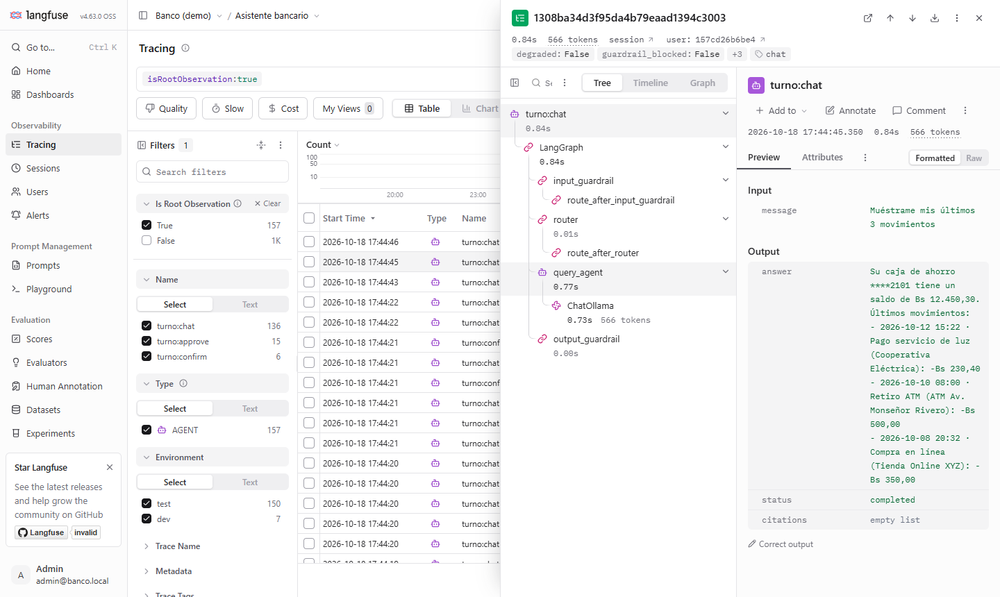
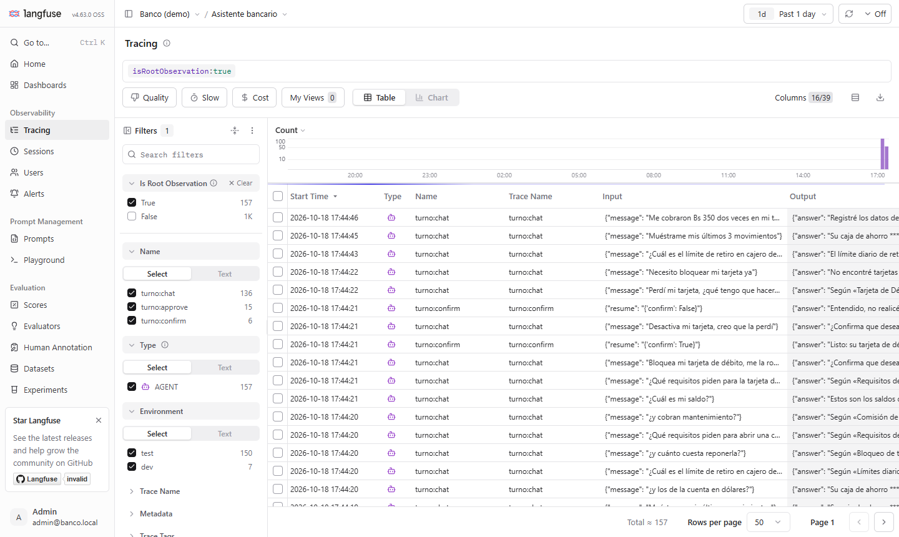

# Observabilidad con Langfuse (self-hosted)

Cada turno del asistente queda como una **traza** en Langfuse 4, que corre en Docker en la misma
máquina: los nodos del grafo, cada llamada al LLM (modelo, tokens, latencia), la sesión (la
conversación) y scores del resultado. Los Evals pueden registrarse ahí también, con un score por
caso para ir de una falla a su traza.



*Un turno con el LLM real: `input_guardrail` → `router` → `query_agent` (ChatOllama, 566 tokens,
0,73 s) → `output_guardrail`. Arriba: scores del turno, usuario seudonimizado y sesión.*

## Qué se registra

| | Dónde | Para qué |
|---|---|---|
| Traza `turno:chat` / `turno:approve` / `turno:confirm` | una por turno | ver el recorrido real del grafo y dónde se va el tiempo |
| Nodos del grafo y llamadas al LLM | observaciones hijas (CallbackHandler de LangChain) | tokens, costo y latencia por nodo y por modelo |
| Sesión = `thread_id` | `session_id` | la conversación completa, multi-turno incluido |
| Usuario = seudónimo | `user_id` (el mismo hash que la analítica) | agrupar por cliente sin identificarlo |
| Scores del turno | `intent`, `status`, `degraded`, `guardrail_blocked`, `latency_ms` | filtrar, por ejemplo, los turnos donde una defensa rechazó al LLM |
| Evals (`--langfuse`) | score `eval_passed` por sesión, con el motivo de la falla | de un caso fallido a su traza en un clic |



## Sin datos personales hacia el servidor de trazas

La entrada de un turno todavía no está enmascarada cuando arranca la traza: el `input_guardrail`
corre **dentro** del grafo. Por eso el enmascarado se hace en dos capas del SDK:

1. `mask`: todo input, output y metadato pasa por el mismo enmascarado de los guardrails (tarjeta
   con Luhn, CI, celular, email, números largos) y el `customer_id` se reemplaza por su seudónimo.
2. `mask_otel_spans`: red de seguridad al exportar, sobre **todos** los atributos de texto de cada
   span. Hizo falta: al pausarse el grafo en HITL, LangGraph registra la interrupción como mensaje
   de estado con el borrador del reclamo y el `customer_id`, un campo que la capa 1 no cubre.

**Cómo se verificó**: se generaron 53 trazas (los 39 Evals más turnos con el LLM real, incluido un
reclamo con tarjeta y email) y se descargaron las 403 observaciones exportadas desde la API de
Langfuse. Ninguna contiene la tarjeta, el email, números de cuenta ni identificadores de cliente.
La primera verificación encontró el `customer_id` en el estado de los nodos y en el mensaje de
estado de la interrupción; las dos capas de arriba son la corrección (con tests).

Y si Langfuse no está configurado o se cae, el chat funciona igual: sin configuración no se
importa el SDK, y cualquier error al registrar se loguea y se ignora.

## Uso

```bash
docker compose -f orchestration/observability/docker-compose.yml up -d
# UI: http://localhost:3100 · admin@banco.local / langfuse-demo-123 (demo local)

# Backend con trazas
LANGFUSE_ENABLED=true LANGFUSE_PUBLIC_KEY=pk-lf-banking-demo LANGFUSE_SECRET_KEY=sk-lf-banking-demo-local \
  uvicorn app.main:app

# Evals con un score por caso
python evals/run_evals.py --langfuse
```

El compose parte del oficial con cambios: todo ligado a `127.0.0.1` (el oficial publica PostgreSQL
en el 5432 y MinIO en el 9090), telemetría de Langfuse apagada e inicialización automática de
organización, proyecto, claves y usuario. Son 6 contenedores (web, worker, PostgreSQL, ClickHouse,
Redis, MinIO) y ~2 GB de RAM.

## Langfuse frente al dashboard propio

El dashboard de KPIs (`#/kpis`) responde **cómo va el negocio** (contención, derivación a humano,
costo por caso de uso) y vive en la demo pública. Langfuse responde **por qué pasó algo en un turno
concreto** (qué nodo, qué prompt, cuántos tokens) y es una herramienta interna del equipo.
Se complementan.
