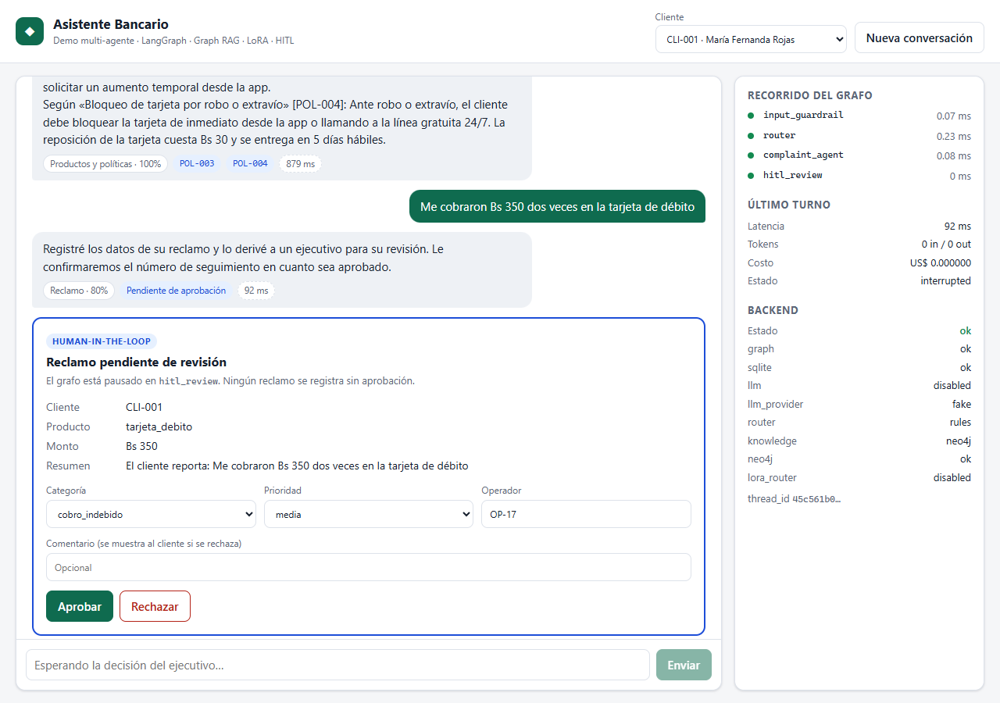

# Frontend — React 18 + Vite + TypeScript

Chat con streaming SSE, progreso del grafo en vivo y aprobación Human-in-the-Loop.



## Qué muestra

- **Streaming SSE** desde `POST /chat/stream` con `fetch` + `ReadableStream` (`EventSource` solo
  admite GET). El parser (`src/api/sse.ts`) maneja eventos partidos entre chunks, tildes UTF-8
  cortadas a la mitad y separadores CRLF; tiene tests en `src/api/sse.test.ts`.
- **Recorrido del grafo en vivo**: cada evento `node` (start/end) se pinta en el panel lateral con
  su latencia, junto a tokens, costo y el `/health` de cada componente.
- **HITL**: cuando llega el evento `interrupt`, aparece la tarjeta del operador con el borrador del
  reclamo (categoría y prioridad editables). El input del cliente queda bloqueado hasta la decisión,
  igual que el backend (que responde 409 si llega un mensaje con un reclamo pendiente).
- **Etiquetas por respuesta**: intención y confianza del router, citas del grafo (POL-xxx), PII
  enmascarada, bloqueo por guardrail y modo degradado.
- Al recibir `final`, el texto acumulado se **reemplaza** por `final.answer`: el `output_guardrail`
  puede haber corregido o enmascarado lo que se emitió como tokens.

## Ejecutar

```powershell
cd frontend
npm install
npm run dev        # http://localhost:5173  (proxy /api → http://localhost:8000)
npm test           # tests del parser SSE (vitest)
npm run build      # type-check estricto + build de producción
```

El backend debe estar corriendo en el puerto 8000 (`uvicorn app.main:app --port 8000` desde `backend/`).
Para otro host: `$env:BACKEND_URL="http://host:puerto"; npm run dev`.

**Enlaces de demo**: `http://localhost:5173/?q=¿Cuál es mi saldo?&cliente=CLI-002` envía la
pregunta al cargar la página.

## Prueba E2E

`e2e/smoke_test.py` recorre la interfaz con clics reales (Playwright sobre el Edge/Chrome
instalado): pregunta con citas, reclamo → editar → aprobar, PII, prompt injection y vista móvil.
Regenera las capturas de `docs/img/`.

```powershell
pip install playwright
python frontend/e2e/smoke_test.py      # desde la raíz, con backend y frontend levantados
```
