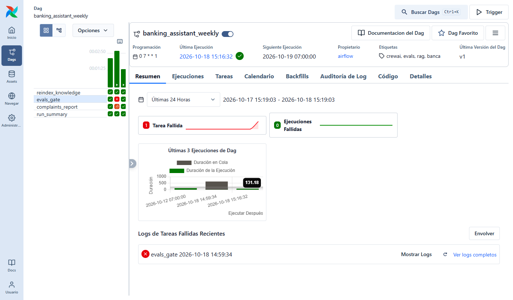

# Orquestación con Airflow

DAG semanal (`orchestration/airflow/dags/banking_weekly.py`, Airflow 3.1) que mantiene el sistema
fuera del camino del cliente:

```
reindex_knowledge ─► evals_gate ─► complaints_report ─┐
                                                      ├─► run_summary (siempre)
```

| Tarea | Qué hace | Por qué así |
|---|---|---|
| `reindex_knowledge` | Recarga productos y políticas en pgvector (upsert por id, idempotente) | Un cambio de política llega al RAG sin redeploy |
| `evals_gate` | Evals de punta a punta **contra la base recién indexada**; exit 1 si una métrica baja del umbral | Compuerta de calidad: una política mal cargada no llega al informe ni a producción. Sin reintentos (un umbral no se arregla reintentando) |
| `complaints_report` | Crew de CrewAI con Ollama on-premise ([crew/](../crew/README.md)) | Solo corre si la compuerta pasó |
| `run_summary` | Resume Evals + advertencias del informe en `run_summary.md` y en XCom | `trigger_rule="all_done"`: también deja constancia cuando algo falló |



En la grilla: la corrida del medio falló en `evals_gate` (✗) y el informe quedó en
`upstream_failed` (no se generó); las otras dos pasaron completas en unos 2 minutos y medio.

## Decisiones

- **Un entorno de Python por tarea.** El backend y CrewAI tienen dependencias incompatibles
  (pydantic, openai, mcp), así que la imagen trae dos venvs y cada tarea llama al suyo: el mismo
  aislamiento que daría `ExternalPythonOperator`, con el comando visible en `@task.bash`.
- **El código no se copia a la imagen**: el repo se monta en solo lectura. La imagen cambia solo si
  cambian las dependencias; los Evals escriben sus reportes en el volumen de salida (`--reports-dir`).
- **Fecha de la corrida con `dag_run.run_after`.** En Airflow 3 una corrida manual no tiene
  `logical_date` y `{{ ds }}` no existe (la primera corrida manual falló por eso).
- **Standalone y sin login solo en local** (puerto ligado a 127.0.0.1). En producción: executor
  Celery o Kubernetes, PostgreSQL como base de metadatos, autenticación del banco y secretos en un
  backend de secretos, no en variables de entorno.

## Airflow frente a Metaflow

| | Airflow (elegido) | Metaflow |
|---|---|---|
| Para qué está hecho | Orquestar procesos programados entre sistemas (bases, servicios, reportes) | Flujos de ciencia de datos / ML: experimentos, versionado de artefactos, escalar pasos a la nube |
| Este DAG | Reindexar → compuerta de calidad → informe, cada lunes | Encajaría mejor en `finetune/`: generar dataset → entrenar LoRA → evaluar → comparar versiones, con cada artefacto versionado |
| En un banco | Suele estar ya operado por el equipo de datos; hay operadores para casi todo | Más natural para el equipo de ML que itera modelos |

El reentrenamiento del router (v1 → v2 → v3, ver [finetune/](../finetune/README.md)) es el candidato
natural para Metaflow: hoy son tres scripts que se corren a mano y los artefactos se versionan a mano.

## Uso

```bash
docker compose up -d pgvector ollama                          # desde la raíz del repo
docker compose -f orchestration/airflow/docker-compose.yml up -d --build
# UI en http://localhost:8088 → banking_assistant_weekly → Trigger
# Resultados en orchestration/airflow/output/<fecha>/ (evals/, complaints_report.md, run_summary.md)
```

`orchestration/airflow/tests/test_dag.py` valida en CI que el DAG importa sin errores y que la
compuerta está donde debe (dependencias, reintentos, `trigger_rule`).
